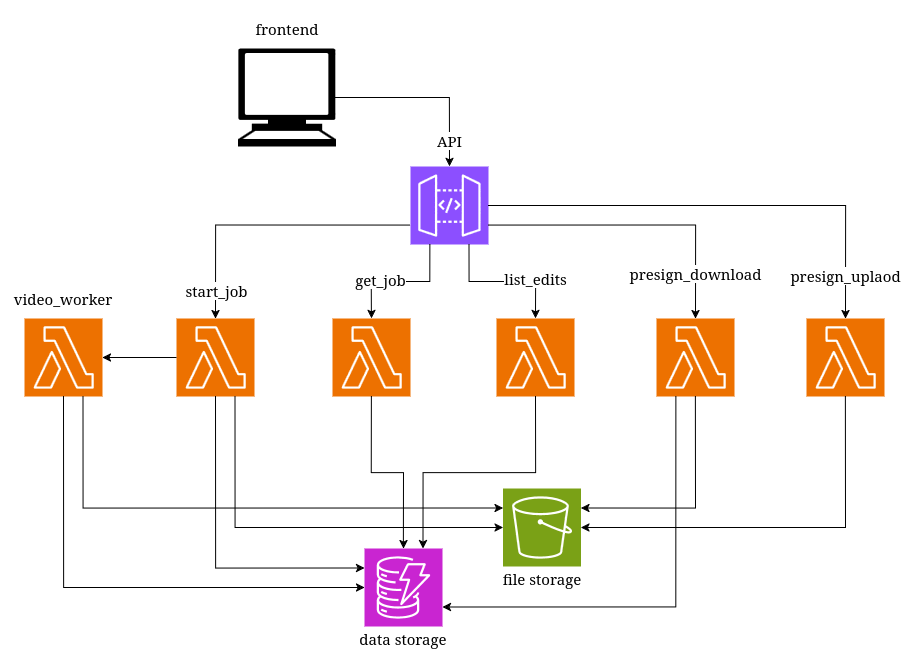

# MiniVide

A serverless app for simple video editing: cut, compress, and (soon!) crop, all in one place. Upload a video, configure your transformations, and download the processed result.

## Architecture

MiniVide runs on AWS using **API Gateway**, **Lambda**, **DynamoDB**, and **S3**.

The API Gateway is the entrypoint to the backend and exposes 5 Lambdas. A 6th Lambda, `video_worker`, is kicked off by `start_job` and does the heavy lifting (running FFmpeg). Most Lambdas talk to S3, DynamoDB, or both.

## API Routes

| Method | Route | Description |
|-|-|-|
| POST | `/uploads/presign` | Get a presigned upload URL   |
| POST | `/downloads/presign` | Get a presigned download URL |
| GET | `/users/{userId}/edits` | List a user's previous edits |
| POST | `/jobs` | Start a new processing job   |
| GET | `/jobs/{jobId}`| Check a job's status         |

## How It Works

1. `start_job` validates the request, file, and metadata, hands the work off to `video_worker`, and returns `202`.
2. `video_worker` downloads the file and runs FFmpeg on it.
3. Meanwhile, the frontend polls `get_job` every 2.5 seconds for live status updates.
4. When processing finishes, `video_worker` updates the job state, the frontend picks it up, and the user can download the result.

### Retry Safety

`video_worker` is expensive, so it's protected against duplicate runs. `claim_job` does a conditional write in DynamoDB that only moves a job from `QUEUED` to `PROCESSING` if nobody has claimed it yet.

## DynamoDB Schema

Single table with a composite key, plus one GSI:

- **PK:** `USER#{userId}`
- **SK:** `JOB#{timestamp}#{jobId}`
- **GSI1:** `GSI1PK = JOB#{jobId}`

Access patterns:

- **List a user's jobs** (`list_edits`): `Query` on the table by PK. The timestamp in the SK gives most-recent-first ordering.
- **Get a job by ID** (`get_job`): `Query` on GSI1 by `JOB#{jobId}`.

No scans anywhere, all queries are key-based.

## Security

- Uploads and downloads use presigned S3 URLs, so nothing is public.
- API Gateway enforces CORS, throttling (dev stage allows roughly 2x the limits), and access logging.
- Users are isolated by S3 prefixes and DynamoDB partition keys.
- Lambdas run with least-privilege IAM roles. The only wildcard resources are for S3 uploads, since users have unlimited uploads.
- Lambdas use `try/catch`, null checks, and validation for file size, type, name, allowed users, and ownership.

## Estimated Cost

Assuming **1,000 jobs/month** with an **average video size of 20 MB**:

| Service | Estimate |
|-|-|
| Lambda (`video_worker`, 2048 MB, ~30s) | ~$1.00 |
| API Gateway (~15,000 requests) | ~$0.015 |
| S3 data transfer (~20 GB out) | ~$1.80 |
| DynamoDB (~15,000 reads/writes) | ~$0.003 |
| **Total** | **~$2/month** |

## Tech Notes

- **Infrastructure as Code:** [Pulumi](https://www.pulumi.com/) with Python, so both the Lambdas and the infrastructure live in a single language.
- **FFmpeg Lambda layer:** a custom minimal FFmpeg build is compiled in an Amazon Linux 2 Docker container, packaged by the IaC, and uploaded as a Lambda layer used by `video_worker`.